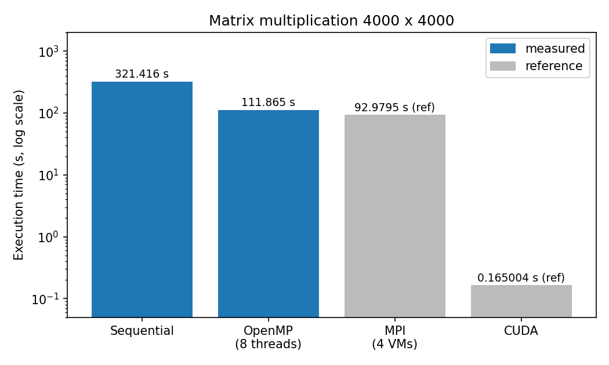
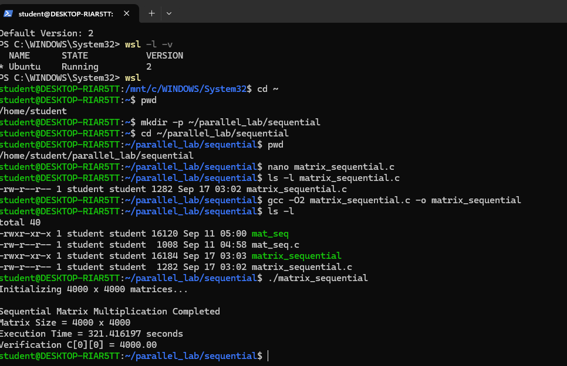
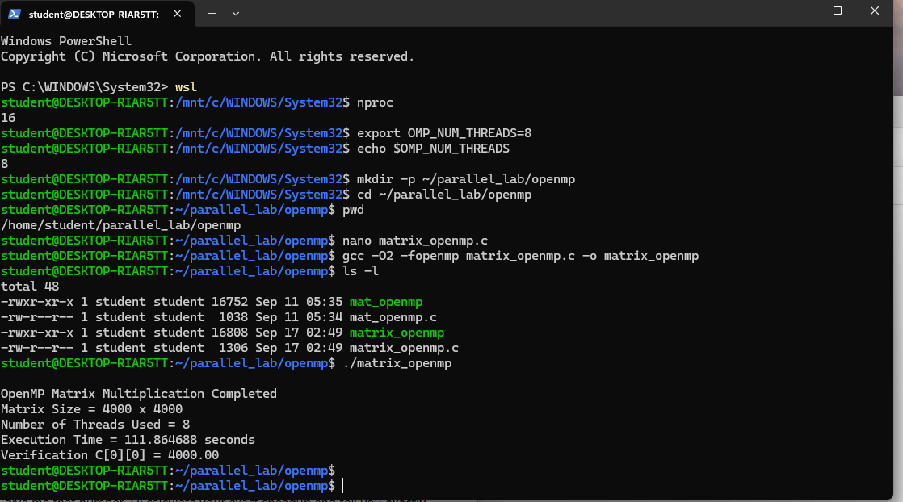
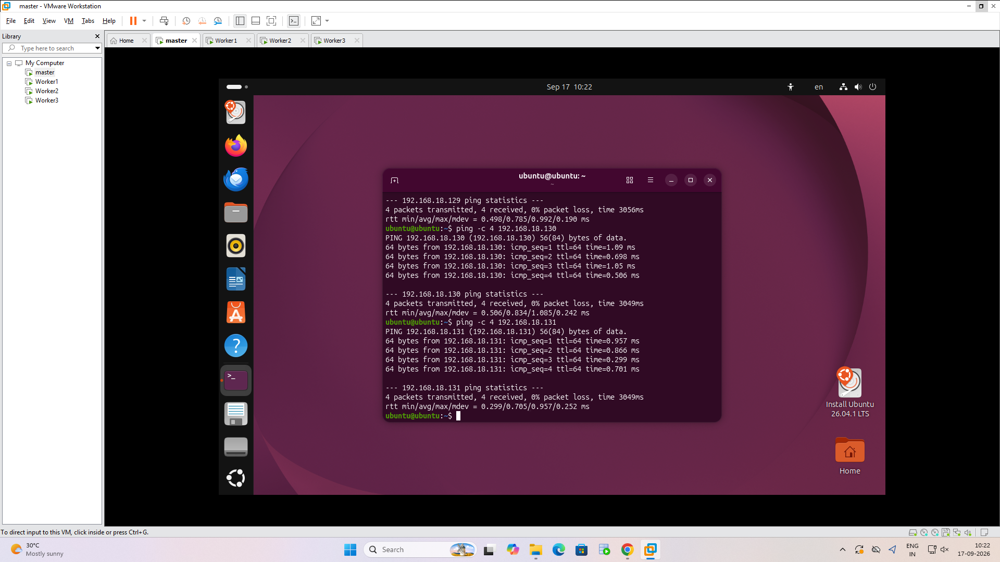
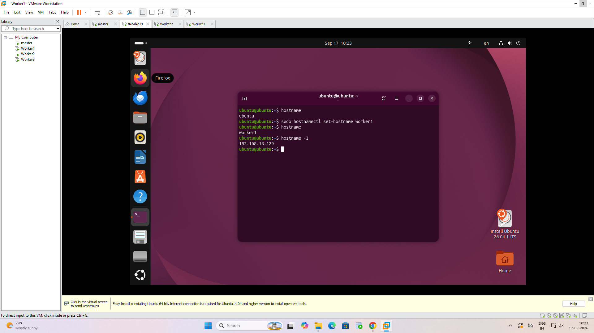
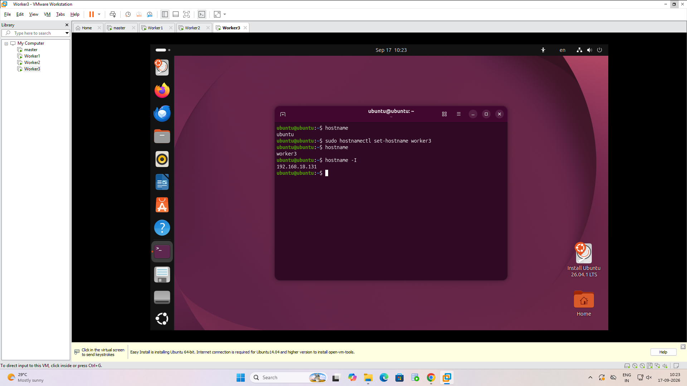

# Experiment 1: Matrix Multiplication (Sequential, OpenMP, MPI, CUDA)

Multiply two 4000 x 4000 matrices four different ways and compare the run times.
A and B are filled with 1.0, so every element of C should be 4000.00. `C[0][0]` is printed as the check.

## Files

| File | Model |
|---|---|
| `src/matrix_sequential.c` | single core baseline |
| `src/matrix_openmp.c` | shared memory, 8 threads |
| `src/matrix_mpi.c` | distributed memory, 4 processes on 4 VMs |
| `src/hosts` | MPI hostfile (master + 3 workers) |
| `src/matrix_cuda.cu` | GPU, 16x16 thread blocks |

## Setup

- WSL2 Ubuntu with `build-essential` for Parts A and B
- 4 Ubuntu VMs (master, worker1-3) on one network with OpenSSH and Open MPI for Part C
- NVIDIA GPU with the CUDA toolkit for Part D

## Build and run

Part A, sequential:
```bash
gcc -O2 src/matrix_sequential.c -o matrix_sequential
./matrix_sequential
```

Part B, OpenMP:
```bash
export OMP_NUM_THREADS=8
gcc -O2 -fopenmp src/matrix_openmp.c -o matrix_openmp
./matrix_openmp
```

Part C, MPI (from the master VM, with passwordless SSH to the workers):
```bash
mpicc -O2 src/matrix_mpi.c -o matrix_mpi
scp matrix_mpi worker1:~/matrix_mpi     # same for worker2, worker3
mpirun -np 4 --hostfile src/hosts sh -c '$HOME/matrix_mpi'
```

Part D, CUDA:
```bash
nvidia-smi
nvcc -O2 src/matrix_cuda.cu -o matrix_cuda
./matrix_cuda
```

## How each version works

- **Sequential**: the plain triple loop, O(N^3). It is the baseline.
- **OpenMP**: same loop with `#pragma omp parallel for private(j, k)`, so the rows are split across threads that share A, B and C.
- **MPI**: rank 0 scatters 1000 rows of A to each of the 4 ranks, broadcasts all of B, every rank computes its rows, and the results are gathered back on rank 0. Separate memory means the data has to be sent explicitly.
- **CUDA**: one GPU thread per element of C. Block 16x16 = 256 threads, grid 250x250 = 62,500 blocks, 16,000,000 threads in total.

## Results

Speedup = sequential time / parallel time. Sequential and OpenMP were run on my machine (screenshots below).
The MPI and CUDA rows are reference values for the same program and are marked as such, until I add my own runs.

| Implementation | Resources | Time | Speedup | C[0][0] | Source |
|---|---|---|---|---|---|
| Sequential | 1 CPU core | 321.416197 s | 1.00x | 4000.00 | measured |
| OpenMP | 8 threads | 111.864688 s | 2.87x | 4000.00 | measured |
| MPI | 4 processes / 4 VMs | 92.979510 s | 2.63x* | 4000.00 | reference |
| CUDA | NVIDIA RTX 4500 Ada | 0.165004 s | 1479.48x* | 4000.00 | reference |

\* Speedup for the reference rows uses the reference sequential time (244.12 s), so it is not comparable with my baseline.



CUDA kernel-only time was 0.146443 s. The 0.165004 s figure also includes the host-to-device and device-to-host copies.

## Screenshots

Part A, sequential run in WSL2 Ubuntu (4000 x 4000, `C[0][0] = 4000.00`):



Part B, OpenMP run with 8 threads (`nproc` shows 16 logical CPUs):



Part C, MPI cluster setup. Ping from the master VM to the three workers, 0% packet loss:



Hostname and IP set on worker1 and worker3:




## Observations

- OpenMP with 8 threads gave 2.87x over sequential on my machine (321.4 s to 111.9 s). That is well below 8x. Every thread reads
  matrix B column by column, which is a poor memory access pattern, so the threads are limited by memory bandwidth and cache misses
  more than by compute.
- MPI has to scatter A, broadcast all of B and gather C over the virtual network, which is overhead the shared-memory versions do not have.
- CUDA is the fastest by a large margin because the problem maps to one GPU thread per output element.
- All versions give the same check value, 4000.00.

## Troubleshooting

| Problem | Fix |
|---|---|
| `gcc` not found | `sudo apt update && sudo apt install build-essential -y` |
| OpenMP build fails | add `-fopenmp` |
| Fewer threads than expected | check `nproc` and `echo $OMP_NUM_THREADS` |
| SSH asks for a password | run `ssh-copy-id` from the master to each worker |
| `mpirun` cannot start workers | check hostfile names, SSH, and that the binary exists on every worker |
| `nvcc` not found | check the CUDA toolkit install and PATH |
