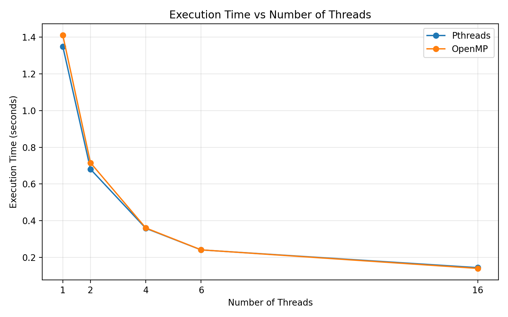
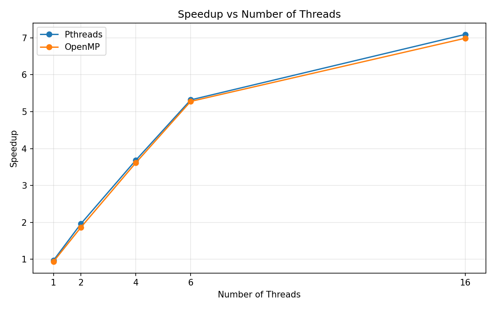
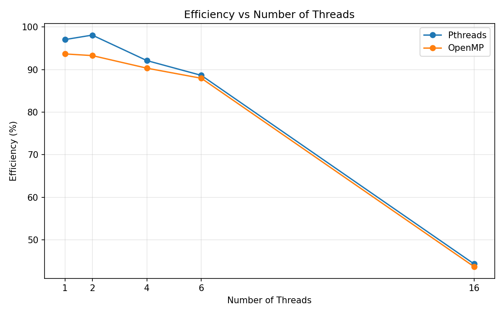

# Experiment 2: Multithreading with Pthreads and OpenMP

Create and manage threads, divide work between them, see a race condition and fix it,
then measure how run time changes with the number of threads.

## Programs (`src/`)

Part A, Pthreads
| File | What it shows |
|---|---|
| `thread1.c` | create one thread, `pthread_create` / `pthread_join` |
| `thread2.c` | create 4 threads, output order is not guaranteed |
| `thread_sum.c` | split an array sum between 4 threads |
| `race.c` | race condition on a shared counter |
| `mutex.c` | the same counter fixed with a mutex |
| `pthread_perf.c` | timing with 1 to 16 threads |

Part B, OpenMP
| File | What it shows |
|---|---|
| `omp1.c` | parallel region, thread id and thread count |
| `omp_sum.c` | `parallel for` with `reduction` |
| `omp_race.c` | race condition in OpenMP |
| `omp_critical.c` | fixed with `critical` |
| `omp_barrier.c` | `barrier` between two stages |
| `omp_perf.c` | timing with 1 to 16 threads |

Part C, baseline
| File | What it shows |
|---|---|
| `sequential.c` | single thread sum of 10^9 terms, used as the baseline |

## Build and run

```bash
# Pthreads
gcc thread1.c -o thread1 -pthread && ./thread1

# OpenMP
gcc omp1.c -o omp1 -fopenmp && ./omp1

# performance (asks for the number of threads)
gcc sequential.c -o sequential && ./sequential
gcc pthread_perf.c -o pthread_perf -pthread && ./pthread_perf
gcc omp_perf.c -o omp_perf -fopenmp && ./omp_perf
```

## Race condition

Four threads each add 1 to a shared counter 100000 times, so the answer should be 400000.
Without protection the printed value is lower and changes from run to run, because two threads can read the same
old value and both write back the same new one. A mutex (Pthreads) or `#pragma omp critical` (OpenMP) makes it 400000 every time.

## Performance results

The timings below are reference values for these programs on a 16-thread machine, not my own runs.

Sequential baseline: 1.353219 s (average of 5 runs).

| Threads | Pthreads (s) | OpenMP (s) |
|---|---|---|
| 1 | 1.348142 | 1.409294 |
| 2 | 0.680737 | 0.715560 |
| 4 | 0.358872 | 0.360803 |
| 6 | 0.241345 | 0.241608 |
| 16 | 0.144812 | 0.140692 |

Speedup = sequential time / parallel time. Efficiency = speedup / threads.

| Threads | Pthreads speedup | OpenMP speedup | Pthreads efficiency | OpenMP efficiency |
|---|---|---|---|---|
| 1 | 1.004x | 0.960x | 100.38% | 96.02% |
| 2 | 1.988x | 1.891x | 99.39% | 94.56% |
| 4 | 3.771x | 3.751x | 94.27% | 93.76% |
| 6 | 5.608x | 5.601x | 93.45% | 93.35% |
| 16 | 9.345x | 9.618x | 58.40% | 60.11% |





## Pthreads vs OpenMP

| | Pthreads | OpenMP |
|---|---|---|
| create threads | `pthread_create()` | `#pragma omp parallel` |
| wait | `pthread_join()` | implicit at the end of the region |
| split work | done by hand | `parallel for` |
| protect shared data | mutex | `critical` |
| sync | join | `barrier` |
| combine results | done by hand | `reduction` |

## Conclusion

Both libraries cut the run time a lot as threads were added, with almost the same numbers.
Speedup is not linear: at 16 threads it is about 9.6x, not 16x, because of thread management, scheduling,
memory access and the part of the program that is not parallel. Shared data needs a mutex or `critical`,
otherwise the result is wrong.
